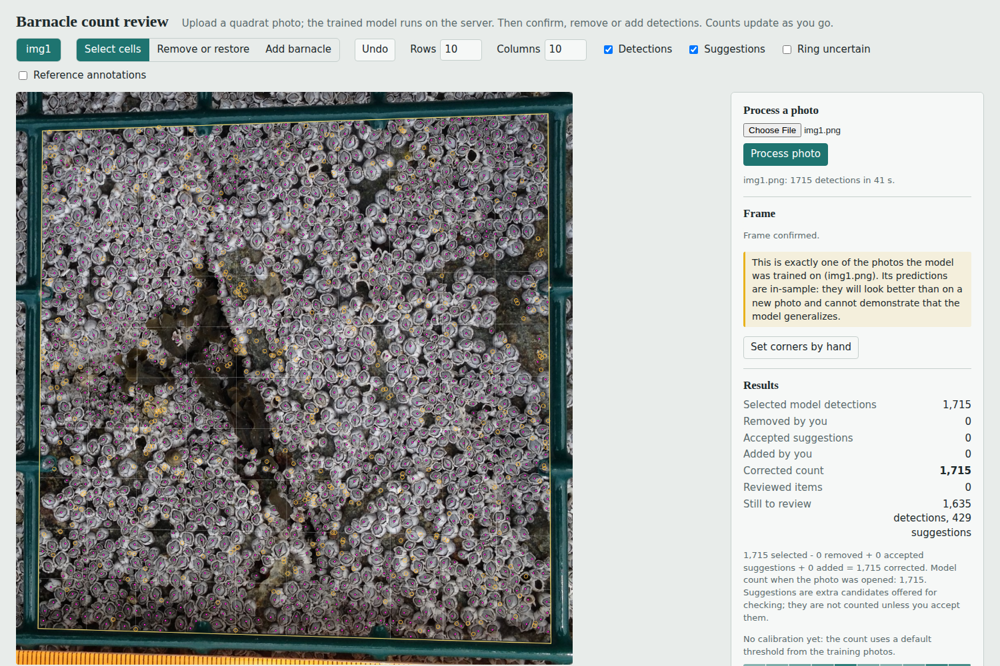
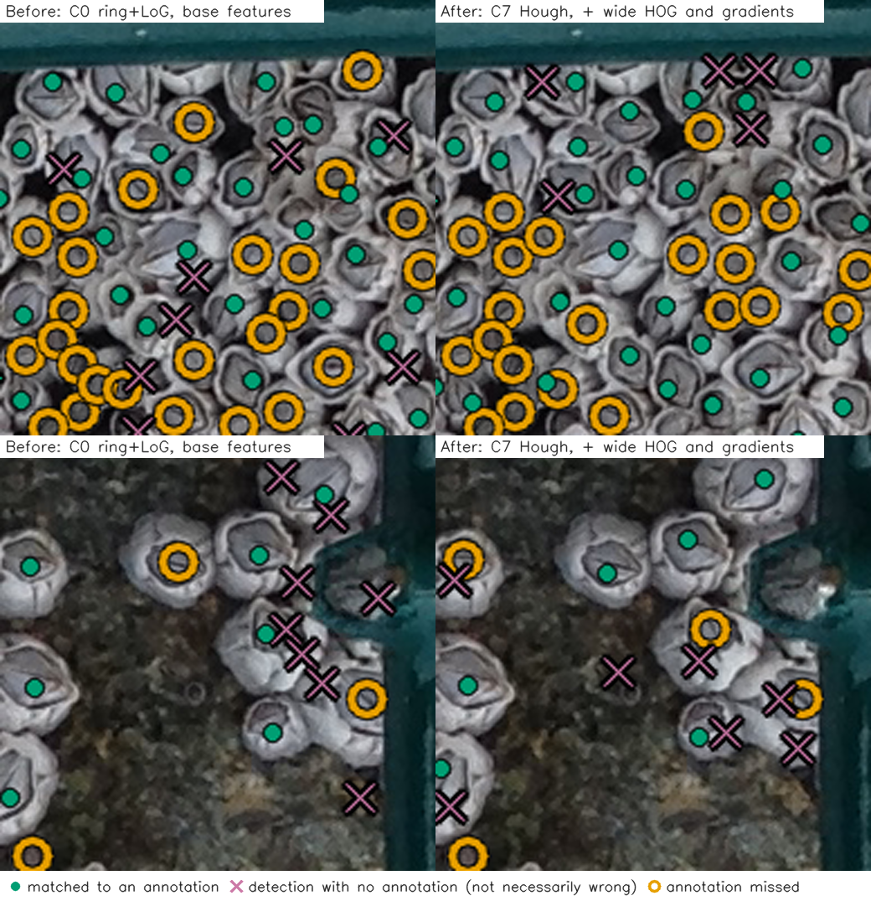
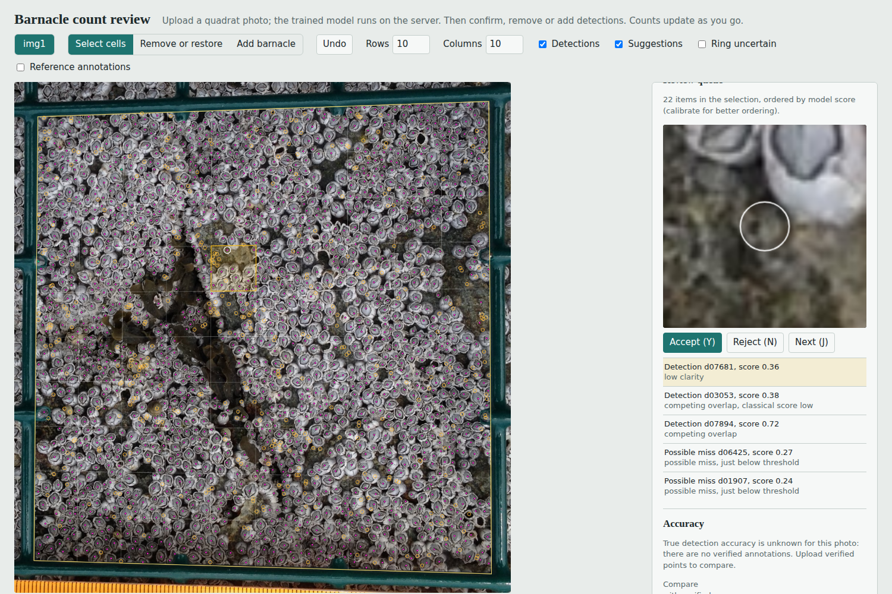
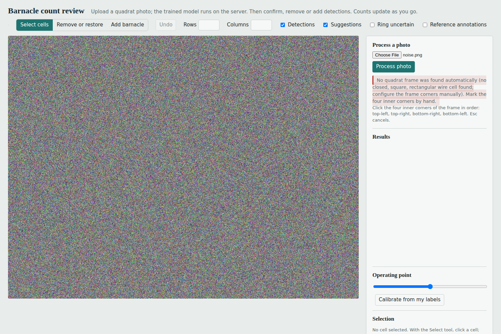
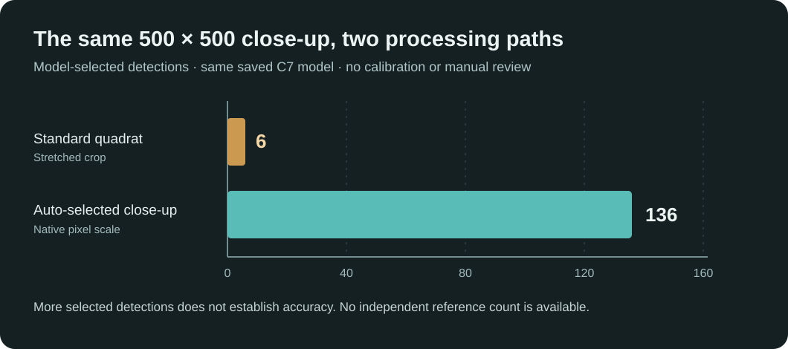

# Counting barnacles with a model and a human

Scientists count barnacles by hand in quadrat photos: a green wire frame laid on the rock, photographed from above, with hundreds to thousands of barnacles inside it. My goal for the DALI challenge was not to replace that person. It was to take the repetitive part off their hands: let a model propose every barnacle, show the scientist where it is unsure, and make correcting it fast.

**[Try the live application](https://haaris-usman-saeed-30--barnacle-counter-serve.us-east.modal.run/)** · [Technical report](TECHNICAL_REPORT.md) · [Deployment notes](DEPLOYMENT.md)

The live demo runs on Modal with on-demand startup, so the first visit may take longer. It accepts PNG/JPEG photographs and automatically chooses quadrat processing or experimental native-scale processing for small frame-free close-ups; users can override that choice. Counts still require review.

The result is a small web app. You upload a quadrat photo; the server finds the frame, corrects the perspective, proposes candidate barnacles, scores them with a trained classifier, and opens the result in a review interface. There you accept, remove or add barnacles, calibrate the model on a few labels from that photo, and export the corrected coordinates and counts.



## The pipeline

```
 upload photo
     |
     v
 find the inner green frame  ---- fails or looks wrong? -->  click the 4 corners by hand
     |
     v
 warp the frame to a 1600 x 1600 square          (perspective fixed, scale relative to the frame)
     |
     v
 propose candidates: Hough circles                (high recall, many false candidates)
     |
     v
 score each candidate: HOG, radial profiles, LBP, gradient boosting
     |
     v
 suppress duplicates, map back to photo pixels and to (u, v) frame coordinates
     |
     v
 review: queue of uncertain items, accept / remove / add, undo, calibrate from ~80 labels
     |
     v
 export corrected points (CSV) and the full session (JSON, replayable)
```

Each barnacle is a point with its own ID. The grid is only a way to organize and count those points, so changing it from 10 x 10 to 7 x 13 never changes a detection.

## How my thinking evolved

### 1. What problem am I actually solving?

I first thought of this as image classification. The question that mattered was whether we could automate enough of the counting to meaningfully reduce a scientist's workload. Fairly quickly I realized that perfect automation was not the realistic, or even the most useful, target. A count nobody can check is worth less than a count a person can verify quickly.

### 2. First idea: split the frame into tiles

My first plan was to cut the frame into tiles, use a cheap classifier to decide which tiles contain barnacles, and send only those to a more precise detector. Looking at the photos killed this. In a dense quadrat almost every tile contains barnacles, so a yes/no tile filter would remove almost no work. That pushed me toward detecting individual barnacles.

### 3. Coordinates instead of tile counts

I also did not want to stamp big numbers over the photo, hiding the very things the scientist has to look at. So I decided every barnacle should be a coordinate with a unique ID, drawn as a small dot, and that counts per region would be computed from those points. The grid became a flexible view on top of the points, not the thing being stored.

### 4. Getting labels out of the masks, without trusting them too much

The challenge provides blue contour masks. The extraction step turns each outline into one center: 1,731 in the first photo and 397 in the second. Looking at the overlays, I noticed the outlines trace the barnacle's opening (the operculum), not the whole shell. They are also incomplete:
- nothing outside the central opening of the frame is annotated;
- empty shells are skipped;
- the second photo misses some live barnacles.

That shaped every later decision. An unannotated spot is not "background", so:
- an unmatched detection is never called a false positive;
- precision is reported only as a lower bound;
- training negatives come only from candidates clearly away from any annotation;
- I checked a random 96 of those negatives by eye to see how many were actually barnacles.

### 5. A coordinate grid that follows the actual frame

The frame defines the sampled area, so counts have to be relative to it, not to the photo. The frame is also not a neat rectangle in the image. In the first photo it is rotated about 2 degrees and keystoned (one side is 88 px longer than the other). Normalizing by the frame's bounding box would have put 293 of the 1,731 centers in the wrong cell of a 10 x 10 grid.

So the four inner corners are mapped to a unit square with a homography. Every point gets coordinates (u, v) between 0 and 1. One assignment rule (half-open cells, last row and column closed) puts each point in exactly one cell for any grid size, and every run checks that the cell counts add up to the points inside the frame. The frame is found from the photo's pixels alone (the largest closed, roughly square cell of teal wire). If that fails, the user marks the corners.

### 6. A classical baseline first, then a learned classifier

I wanted to know how far plain image processing gets before training anything, so I would know whether learning earned its complexity. Averaging the image around every annotated center showed the two photos look different:
- in the first, the opening is grey inside a bright white shell;
- in the second, it is the brightest spot on a dark background.

A standard bright-blob detector found only 37% of the first photo's annotations, because it fired on the shell walls. A "dark rim around a lighter center" filter combined with the blob detector covered 96% to 100% of annotations, at 8 to 29 candidates per annotated barnacle. No classical score separated openings from rock texture well (best F1 around 0.2 to 0.4).

So the learned part is a classifier that rescores those candidates. It uses HOG, radial intensity profiles, texture and the detector responses, with gradient boosting. Because there are only two photos, the evaluation I chose is cross-photo: train on one, test on the other, in both directions. Adding colour made it worse; the two photos differ completely in colour.

### 7. The model ranks well but does not know where to stop

The most useful thing I learned was the gap between ranking and deciding. The classifier ranks candidates far better than any classical score. But a threshold learned on one photo landed in the wrong place on the other: in one early run it accepted 51 detections on the second photo and 4,692 on the first. The photos differ in barnacle size, colour, lighting and density, and the labels are incomplete, so a score of 0.4 does not mean the same thing on both.

The fix I chose is to calibrate on each new photo. The reviewer labels a stratified sample of 80 candidates; the app estimates how many barnacles there are and sets the threshold to match. It works but is noisy. In one test, a single wrong label moved the first photo's count from 1,623 to 2,464.

The cause is the sample weighting: low-score candidates are a huge group represented by a handful of labels, so one stray "yes" there is multiplied by thousands. Two changes help:
- the estimated barnacle rate is forced to rise with the score, so an isolated low-score "yes" is averaged with its neighbours;
- any label whose flip would move the count by more than 10% is flagged for the reviewer to confirm.

On the second photo, the average worst-case effect of one flipped label dropped from 295% to 115%, and to about 5% once flagged labels are confirmed. (A bug that sampled 72 labels when 80 were requested is also fixed.)

### 8. Better candidates, then better features

The previous round left a hunch that Hough-circle proposals might cover more barnacles, so I tested it with candidate generation measured separately from classification. Within half an opening's radius, Hough proposals cover 88% of the first photo's annotations, against 54% for my original generator, and they produce fewer candidates. On top of that, a wider HOG patch and radial edge features helped a little.

Several things did not help:
- normalizing features per photo;
- a random forest;
- contrast augmentation (mixed results);
- moving each detection to the classifier's local maximum, which centered points slightly better but merged neighbouring barnacles, so I rejected it.

| | C0 (original) | C7 (kept) |
|---|---|---|
| Average precision, test img2 / img1 | 0.31 / 0.55 | **0.40 / 0.70** |
| F1 after 80 simulated labels, img2 | 0.34 ± 0.06 | 0.36 ± 0.10 |
| F1 after 80 simulated labels, img1 | 0.55 ± 0.01 | 0.67 ± 0.03 |
| Annotations matched at the annotated count, img1 / img2 | 983 / 154 | 1,210 / 168 |

**An honest caveat about these numbers.** I chose C7 while looking at results on the same two photos that score it, and three of the ten variants were added after seeing the first results. With two photos, model selection is partly tuned to them, so C7's advantage is likely somewhat optimistic. C7 also has the noisiest calibrated F1 on the second photo.

Both models are shown below at the same count, the number of annotations, so the picture compares which barnacles each one ranks highest:



### 9. Human review, on purpose

Fully automatic counting would have meant hiding these uncertainties. Instead, the model does the repetitive part (finding and placing hundreds of points), and the scientist handles the ambiguous cases:

1. **Check the frame.** An automatically found frame stays marked unconfirmed until you confirm it, or set the corners by hand.
2. **Calibrate.** Label the sampled candidates as "opening" or "not". The app sets the threshold from your labels and asks you to re-check any label with outsized influence.
3. **Work the queue.** Items are ordered by how likely they are to be counting errors: low-scoring selected detections first, plus "suggestions" (unselected candidates just below the threshold). Accept or reject each one with Y or N, or click on the photo to remove a detection or add a missed barnacle. Undo works for every action.
4. **Export.** Download the corrected points (CSV) and the session (JSON). The session replays to the identical result and can be loaded back in.

The dashboard keeps the numbers separate, and checks they add up:
- selected model detections;
- removed by you;
- accepted suggestions;
- added by you;
- reviewed items;
- detections and suggestions still to review;
- the corrected count, which equals selected minus removed plus accepted suggestions plus added.

In a simulation with the earlier model, using the annotations as the reviewer, checking 100 queued items found 45 errors on the first photo against 38 for random checking, and 77 against 53 on the second. That is useful, but a modest gain.



### 10. From a demo to an application

Earlier versions only displayed predictions computed in advance, which a scientist cannot use. So I made upload-and-inference the main path. The server runs the saved model on the uploaded photo with the same preprocessing, features and coordinate conventions as training, and no annotation file is involved.

The app is built to fail honestly:
- an unusable file gets a specific error;
- a missing frame leads to a request for corners;
- server load is limited;
- without verified points, it says true accuracy is unknown;
- if the upload looks like one of the training photos, it says so and explains that those predictions cannot show generalization. An exact copy is reported as definitive; a resized or recompressed copy only as a likely match.



### 11. What I learned, and what I would do next

- **Look at the data before choosing a method.** The averaged appearance around annotations told me more than any parameter sweep.
- **Ranking and counting are different problems.** A model can be good at the first and still need a person's help on each new photo for the second.
- **Incomplete labels limit what you can claim.** Much of my effort went into not overstating results.
- **Separate the stages when evaluating.** Measuring candidate generation on its own is what showed the Hough improvement.

Next steps, in order:
1. More photos, with a few patches labelled exhaustively. Two photos cannot show generalization.
2. Better recall in dense clusters.
3. Calibration that needs fewer labels.
4. Retraining on reviewers' corrections, which the export format already supports.
5. Deciding with scientists whether empty shells should count.

## Results at a glance

These are cross-photo results (the model never saw the photo it is scored on), against incomplete annotations. Model choices were informed by both photos (see section 8).

| | C0 (original) | C7 (current) |
|---|---|---|
| Average precision, test img2 / img1 | 0.31 / 0.55 | 0.40 / 0.70 |
| Candidate recall within 0.25 diameters, img1 / img2 | 54% / 82% | 88% / 93% |
| Count error after 80 labels (mean absolute), img1 / img2 | not measured | 25% / 53% |
| Processing time, 3264 x 2448 photo, 1 CPU | | about 30 s |

Every experiment, the failure analysis and the calibration study are in [`TECHNICAL_REPORT.md`](TECHNICAL_REPORT.md). The full model table is in [`experiments/classifier_table.md`](experiments/classifier_table.md).

## Applying the solution to additional photographs

**A design oversight I corrected.** I knew from the outset that incoming photos could have different pixel dimensions, and that some photos might not have a clearly detectable quadrat. The pipeline handled varying input dimensions and allowed manually marking frame corners. However, I initially treated every selected counting region as if it should be rescaled to the same **1600 × 1600 working area**. That 1600-pixel size was an internal normalization, **not the original dimensions of the training photographs**. I had not accounted for how strongly rescaling a tightly cropped photo would change the apparent barnacle sizes. The close-up test exposed this weakness, and only afterward did I add the native-scale alternative. This improvement was informed by the additional photo; it is not evidence from an independent evaluation of the revised method.

To see what the deployed system actually does beyond the two development photographs, I uploaded two additional, previously unused photographs through the [live app](https://haaris-usman-saeed-30--barnacle-counter-serve.us-east.modal.run/). Neither was used to train or select the model. I recorded the **initial model outputs**, without manual corrections or per-photo calibration. These are observations from deployment, **not benchmark accuracy scores**: I do not have exhaustive reference counts for these photographs.

### Test 1 — New full-quadrat photograph

The normal workflow automatically located the green wire frame, rectified the central opening, generated candidate barnacles, and scored them with the trained C7 classifier. In the resulting review screen, I confirmed the frame. The yellow outline followed the central opening, and many selected dots appeared near visible barnacle openings. Some visible openings were not selected.

| Measurement | Observed result |
|---|---:|
| Mode | Standard quadrat |
| Server processing time reported in the app | **13 seconds** |
| Selected model detections | **1,172** |
| Additional suggestions (not counted) | 293 |
| Remaining selected detections in review queue | 1,115 |
| Reviewed items | 0 |
| Manual removals / accepted suggestions / additions | 0 / 0 / 0 |
| Displayed count | **1,172 (uncalibrated)** |

The dashboard labels 1,172 as the “corrected count,” but because I made no review edits, it is simply the model's starting count. It should not be interpreted as a verified count.

### Test 2 — New 500 × 500 close-up: an unexpected failure

The second photograph was a tight crop of barnacles **without a green quadrat frame**. I selected the image area manually and tried the ordinary quadrat processing path. This returned only **6 selected detections and 2 suggestions**, despite many visible barnacles. Expanding a small crop to the same 1600 × 1600 rectified working size as a full quadrat changes the apparent size of each barnacle. That is a plausible source of failure because candidate detection and classification were tuned on full quadrat images, but I have not isolated scale as the sole cause.

Rather than retraining C7 on this additional photograph, I added an **experimental native-scale close-up mode** and tried the same crop again.

**How I applied the proposed fix:**

1. The new mode treats the **entire uploaded crop** as the counting area; it does not require a green quadrat.
2. Instead of stretching a 500 × 500 crop to 1600 × 1600, the pipeline preserves the image at **its original pixel resolution**.
3. An **88-pixel reflected border** supplies context for local filters without creating a large black canvas or artificial high-contrast black edges. The extra border is not part of the counted area.
4. Candidate locations are restricted to the original crop and mapped directly back to its pixel coordinates. The app uses the **same saved C7 classifier and threshold**, with no additional training.
5. Standard full-quadrat processing remains a separate, unchanged mode.
6. After observing this failure, I made the app **inspect each uploaded photo first** and route it automatically to the framed or native-scale pipeline. A processing selector remains available for overrides.

| Measurement | Original quadrat processing | Native-scale close-up mode |
|---|---:|---:|
| Input | Same 500 × 500 crop | Same 500 × 500 crop |
| Selected model detections | **6** | **136** |
| Extra suggestions (not counted) | 2 | 34 |
| Remaining selected detections in review queue | 6 | 131 |
| Server processing time reported | Not recorded | **2 seconds** |
| Reviewed items | 0 | 0 |
| Manual removals / accepted suggestions / additions | 0 / 0 / 0 | 0 / 0 / 0 |
| Displayed count | 6 (uncalibrated) | **136 (uncalibrated)** |

The second run located many more plausible barnacle centers, with visibly more dots near openings. **136 versus 6 is an increase in selected detections, not proof of improved accuracy.** The new run still appears to miss many barnacles, and without a verified reference count I cannot calculate precision, recall, or count error. It also remains possible that some of the 136 selected points are false positives.

### Automatic routing verified in the deployed app

I also retested both photographs using the updated **Auto-detect photo type** option, without manually selecting either mode. The app found the green quadrat on the full-frame photograph and selected perspective normalization. On the 500 × 500 frame-free close-up, it reported that no green frame was found and automatically chose the native-scale pipeline. The uploaded photos were not added to model training.

| Live upload with Auto mode | Full quadrat | Frame-free close-up |
|---|---:|---:|
| Selected processing path | Perspective-normalized quadrat | Native-pixel close-up |
| Initial selected detections | **1,172** | **136** |
| Remaining selected detections for review | 1,115 | 131 |
| Additional unselected suggestions | 293 | 34 |
| Processing time in this auto-mode run | **21 s** | **3 s** |
| Reviewer edits / calibration | None | None |
| Independently verified count | Unavailable | Unavailable |

The counts matched the previously recorded runs for their respective processing paths; processing times varied between runs (earlier: 13 seconds for the quadrat and 2 seconds for the native-scale close-up). These are two different-sized photographs, so their detection totals must **not** be compared as though they represent model accuracy.



The chart compares **6 selected detections using standard quadrat processing** against **136 using native-scale processing** on the *same close-up*. It shows changed selection behavior, not precision, recall, or verified counting accuracy. The screenshots demonstrate that the automatic routing logic makes the intended selection without the user flipping the processing mode.

### What I learned from deploying it

This test surfaced a failure that the two development photographs did not reveal: **image framing and object scale are part of the model's input distribution**. The native-scale experiment improved the number and visual coverage of predictions on one close-up, without new training, but it did not establish that the model counts close-ups reliably.

After this observation, I also updated the user interface to **select a processing mode automatically**: it first tries to locate the green quadrat; if a small (up to 1200 pixels per side) photo has no detectable frame, it selects native-scale close-up processing. Larger frameless images still ask for manual corners, and the user can explicitly override automatic selection. A detected green frame continues to use standard perspective normalization. This routing rule is a heuristic, not a learned classifier for photo type.

The user interface retains the review queue and labels uncalibrated counts as estimates. For close-ups, the grid organizes relative positions within the crop; it is **not** a physical quadrat or an area-density measurement. I would next validate the approach on several independent close-ups with exhaustive point annotations before making stronger performance claims.

## Honest limitations

- **Only two photos.** None of these numbers predicts performance on other photos, species or lighting.
- **Counts still need review.** With 80 labels, the count estimate is typically off by about 25% on the first photo and 50% on the second.
- **Annotations define the target.** The masks skip empty shells, and the second photo is incompletely annotated, so measured recall and precision follow that policy.
- **The deployed model saw both photos.** It is trained on both development photos, so processing either of them in the app gives optimistic results. The app warns: definitively for exact copies, and as a "likely" match for resized or recompressed ones. Crops and strong edits may not be recognized.
- **Dense clusters lose recall.** About 1% to 2% of annotations are never proposed as candidates.
- **Tight close-ups remain difficult.** An additional 500 × 500 crop produced 6 detections in standard mode and 136 in experimental native-scale mode. This improved visual coverage but remains an apparent undercount, with no verified accuracy measurement.

## Run it

Web app (Python 3.12):

```
pip install -r requirements.txt
python app.py                         # open http://127.0.0.1:8000 and upload a PNG or JPEG
```

The trained model (`models/barnacle_detector.pkl`) and the training-photo fingerprints ship with the code. Nothing else is needed to process uploads.

Deployment: the [live demo](https://haaris-usman-saeed-30--barnacle-counter-serve.us-east.modal.run/) is hosted on Modal using [`modal_app.py`](modal_app.py) and the existing Dockerfile. Re-deploy with `modal deploy modal_app.py` after `modal setup`. For other platforms use `gunicorn -c gunicorn.conf.py app:app`, the `Dockerfile`, or `Procfile`; see [`DEPLOYMENT.md`](DEPLOYMENT.md) for resource requirements and limitations.

Research workflow: put the challenge photos and masks in `data/` (or set `BARNACLE_DATA`), then:

```
pip install -r requirements-dev.txt
python run_phase1.py && python run_phase2.py && python run_phase3.py   # annotations, frame and grid, original baseline vs ML
python scripts/run_experiments.py prepare                              # this round's experiments (about 15 min on 1 CPU)
python scripts/run_experiments.py generators
python scripts/run_experiments.py classifiers
python scripts/run_experiments.py refine C7
python scripts/run_experiments.py calibration C7
python scripts/before_after.py && python scripts/build_demo.py
python train_model.py                                                  # the deployed model, about 4 min
python -m unittest discover -s tests -t .                              # tests; data-dependent ones skip without data/
```

`phase4_output/review.html` is an offline demo where each photo is shown with the model trained only on the other photo, so the mistakes you see are real cross-photo mistakes.

## Where things are

| Path | What it is |
|---|---|
| `app.py`, `gunicorn.conf.py` | Flask server: upload, processing, resource limits, comparison against verified points |
| `barnacles/fingerprint.py` | Recognizes uploads that may be the training photos |
| `barnacles/inference.py` | Upload validation and the full inference pipeline |
| `barnacles/frame.py`, `grid.py`, `rectify.py` | Frame detection, coordinates, grid |
| `barnacles/candidate_detection.py`, `features.py`, `ml.py` | Candidates, features, classifier |
| `barnacles/calibration.py` | Per-photo calibration and the count estimator |
| `barnacles/review.py`, `review_viewer.py` | Review rules and the interface |
| `barnacles/extract.py` and friends | Annotation extraction from the masks |
| `scripts/` | Experiments, figures, demo builder, frame robustness test |
| `experiments/` | Experiment results (JSON), table, before and after figures |
| `TECHNICAL_REPORT.md` | Full experimental record |
| `PHASE1.md`, `PHASE2.md` | Notes from the annotation and coordinate phases |
